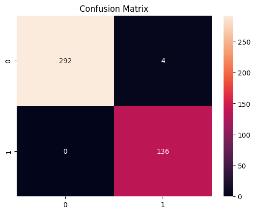
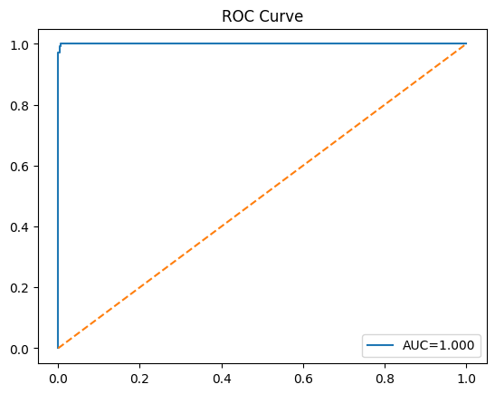
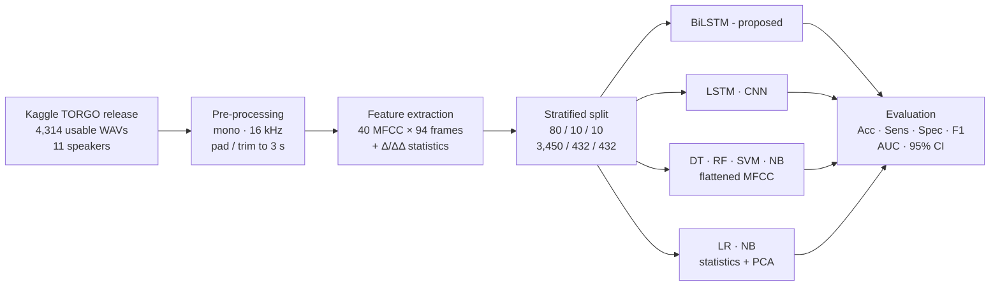
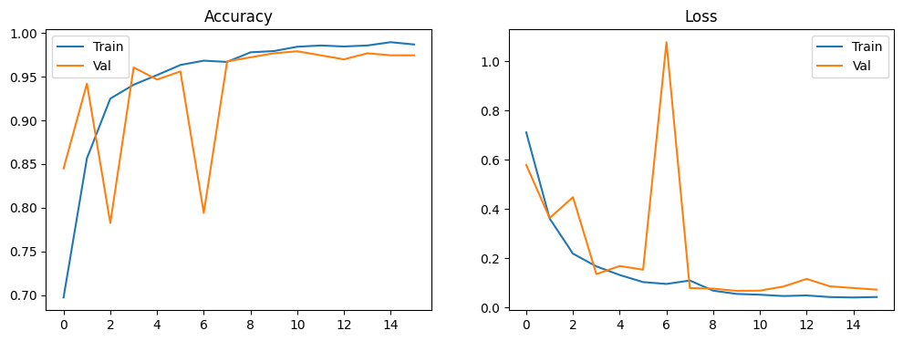

<div align="center">

# DysBiLSTM

[](https://www.python.org/)
[](https://www.tensorflow.org/)
[](https://scikit-learn.org/)
[](LICENSE)

</div>

---

DysBiLSTM is the official implementation of the paper *"A Bidirectional LSTM Framework for Automatic Dysarthric Speech Detection from Mel-Frequency Cepstral Representations"*. It detects dysarthric speech with a compact two-layer bidirectional LSTM (0.35 M parameters) that reads 40-coefficient MFCC sequences. The repository also includes a CNN, a unidirectional LSTM and six classical machine-learning baselines, all trained and tested on **the same stratified partitions**.

<p align="center">
  
  
</p>

## Highlights

- **Lightweight sequence model:** 347,330 parameters. It trains on a CPU in minutes.
- **High sensitivity:** on the held-out test set the BiLSTM detected all 136 dysarthric utterances (100% sensitivity, 98.65% specificity).
- **Controlled benchmark:** BiLSTM, LSTM, CNN, Random Forest, Decision Tree, SVM, Logistic Regression and two Gaussian Naive Bayes variants, all on identical splits.
- **Reproducible protocol:** fixed seeds, deterministic file ordering, a saved split manifest, per-utterance predictions and exact Clopper–Pearson confidence intervals.

## Pipeline



## Results

Test set: 432 utterances (296 control, 136 dysarthric). The dysarthric class is the positive class. These numbers come from the original experiment run in [`notebooks/original_experiments.ipynb`](notebooks/original_experiments.ipynb).

| Model | Input | Acc. (%) | 95% CI (%) | Precision | Sensitivity | Specificity | Macro F1 | AUC |
|---|---|---:|---|---:|---:|---:|---:|---:|
| **BiLSTM (proposed)** | MFCC sequence | **99.07** | [97.65, 99.75] | 0.971 | **1.000** | 0.986 | **0.989** | **1.000** |
| LSTM (unidirectional)¹ | MFCC sequence | 99.07 | [97.65, 99.75] | 0.971 | 1.000 | 0.986 | 0.989 | 1.000 |
| SVM (RBF)¹ | Flattened MFCC | 98.61 | [97.00, 99.49] | 0.985 | 0.971 | 0.993 | 0.984 | 0.999 |
| CNN | MFCC image | 94.68 | [92.12, 96.60] | 0.945 | 0.882 | 0.976 | 0.937 | 0.986 |
| Logistic Regression | Stats + PCA | 93.06 | [90.23, 95.27] | 0.908 | 0.868 | 0.959 | 0.919 | 0.967 |
| Random Forest | Flattened MFCC | 91.67 | [88.65, 94.10] | 0.939 | 0.787 | 0.976 | 0.899 | 0.977 |
| Decision Tree | Flattened MFCC | 84.03 | [80.23, 87.36] | 0.764 | 0.713 | 0.899 | 0.811 | 0.820 |
| Naive Bayes (stats) | Stats + PCA | 72.45 | [67.98, 76.62] | 0.567 | 0.529 | 0.814 | 0.675 | 0.788 |
| Naive Bayes (flat) | Flattened MFCC | 62.73 | [57.98, 67.31] | 0.444 | 0.735 | 0.578 | 0.617 | 0.692 |

¹ Additional runs from the original notebook that are not reported in the manuscript.

<details>
<summary><b>BiLSTM training curves</b></summary>
<p align="center"></p>
</details>

## Repository structure

```
DysBiLSTM/
├── dysbilstm/                  # Python package
│   ├── config.py               # Audio, MFCC and split constants (seed = 42)
│   ├── data.py                 # Dataset discovery, speaker IDs, stratified 80/10/10 split
│   ├── features.py             # MFCC matrix and MFCC+Δ+ΔΔ statistics, with on-disk cache
│   ├── metrics.py              # Accuracy, sensitivity, specificity, F1, AUC, Clopper–Pearson CI
│   ├── plots.py                # Confusion matrix, ROC and training-curve figures
│   ├── train.py                # CLI: train and evaluate any subset of models
│   ├── predict.py              # CLI: score new WAV files with a trained model
│   └── models/
│       ├── deep.py             # BiLSTM, LSTM and CNN (Keras) and their training configs
│       └── classical.py        # DT, RF, SVM, NB, LR scikit-learn pipelines
├── notebooks/
│   └── original_experiments.ipynb   # Original Colab notebook with the reported outputs
├── scripts/
│   └── download_dataset.sh     # Fetch the dataset with the Kaggle CLI
├── docs/figures/               # Figures used in this README
├── results/                    # Generated outputs (git-ignored)
├── requirements.txt
├── pyproject.toml
├── CITATION.cff
└── LICENSE
```

## Installation

Requires Python 3.10–3.12.

```bash
git clone https://github.com/<your-username>/DysBiLSTM.git
cd DysBiLSTM

python -m venv .venv
source .venv/bin/activate          # Windows: .venv\Scripts\activate
pip install -r requirements.txt
```

To get the `dysbilstm-train` and `dysbilstm-predict` commands, also run `pip install -e .`.

## Dataset

The experiments use the [**Dysarthria and Non-Dysarthria Speech Dataset**](https://www.kaggle.com/datasets/poojag718/dysarthria-and-nondysarthria-speech-dataset) on Kaggle. It is a community release of the [TORGO database](https://www.cs.toronto.edu/~complingweb/data/TORGO/torgo.html) (Rudzicz et al., 2012). The dataset is **not** included in this repository.

**Option A: Kaggle CLI** (needs an API token in `~/.kaggle/kaggle.json`):

```bash
pip install kaggle
bash scripts/download_dataset.sh data
```

**Option B: manual download.** Download the archive from Kaggle and extract it into `data/`.

The loader accepts the extraction folder or any folder that contains the `Dataset` directory:

```
data/
└── Dysarthria and Non Dysarthria/
    └── Dataset/
        ├── Female_dysarthria/       F01, F03            (label 1)
        ├── Male_Dysarthria/         M03, M04, M05       (label 1)
        ├── Female_Non_Dysarthria/   FC01, FC03          (label 0)
        └── Male_Non_Dysarthria/     MC01–MC04           (label 0)
```

| Group | Speakers | Utterances |
|---|---|---:|
| Dysarthric | F01, F03, M03, M04, M05 | 1,361 |
| Control | FC01, FC03, MC01, MC02, MC03, MC04 | 2,953 |
| **Total** | **11** | **4,314** |

The archive contains 4,316 WAV files. Two F01 files cannot be decoded, so they are skipped automatically.

## Usage

### Train and evaluate

```bash
# Proposed model only
python -m dysbilstm.train --data-root data --models bilstm

# Full benchmark (every model on identical partitions)
python -m dysbilstm.train --data-root data --models all

# A chosen subset
python -m dysbilstm.train --data-root data --models bilstm cnn lr rf
```

Available models: `bilstm`, `lstm`, `cnn`, `dt`, `rf`, `svm`, `nb_flat`, `nb_stat`, `lr`.

Features are cached in `.cache/` after the first run, so later runs skip audio decoding. Pass `--cache-dir ""` to turn the cache off.

### Outputs

```
results/
├── summary.csv                 # One row per model
├── splits.json                 # Exact train / val / test file lists
└── <model>/
    ├── metrics.json            # All test metrics, CI, validation accuracy, parameter count
    ├── predictions.csv         # Per-utterance path, speaker, label, prediction, probability
    ├── confusion_matrix.png
    ├── roc_curve.png
    ├── training_curves.png     # Deep models only
    ├── history.json            # Deep models only
    └── model.keras | model.joblib
```

### Inference on new recordings

```bash
python -m dysbilstm.predict --model results/bilstm/model.keras path/to/recording.wav path/to/folder/
```

## Experimental protocol

| Setting | BiLSTM | LSTM | CNN |
|---|---|---|---|
| Input | 94 × 40 | 94 × 40 | 40 × 94 × 1 |
| Parameters | 347,330 | 140,994 | 110,338 |
| Optimiser / initial LR | Adam / 3e-4 | Adam / 5e-4 | Adam / 1e-3 |
| LR schedule (val. loss) | ×0.1, patience 3 | ×0.1, patience 3 | ×0.5, patience 3 |
| Early stopping (val. loss) | patience 6 | patience 5 | patience 5 |
| Max. epochs / batch size | 25 / 32 | 20 / 32 | 20 / 32 |
| Loss | class-weighted sparse CE | class-weighted sparse CE | class-weighted sparse CE |

The classical models use a `StandardScaler` fitted on the training partition only. LR and NB-stat also use PCA that keeps 95% of the variance. See [`dysbilstm/models/classical.py`](dysbilstm/models/classical.py) for every hyperparameter.

### Reproducibility notes

- All random seeds are fixed at 42.
- Files are sorted before splitting, so the partition is the same on every OS. The original Colab run used the file-system order, so a fresh run may produce a slightly different split, and numbers can differ by a few test utterances.
- GPU kernels for recurrent layers are not bit-exact. The manuscript results were produced on a Colab **CPU** runtime with TensorFlow 2.20.

## Limitations

These results come from an **utterance-level** split: recordings from all 11 speakers appear in both the training and the test sets. Two caveats follow:

1. **Speaker overlap.** Some of the performance may come from recognising speakers rather than dysarthric characteristics. Speaker-independent evaluation, such as leave-one-speaker-out, is expected to give clearly lower scores (see Joshy & Rajan, 2022).
2. **Recording-condition confound.** In TORGO, control and dysarthric recordings differ in their acoustic environment (Schu et al., 2023). Because padding keeps non-speech segments, models may partly use channel cues.

Treat the reported figures as an **upper bound**. `predictions.csv` records the speaker ID of every test utterance, so per-speaker analysis is straightforward.

> **Disclaimer:** This software is a research prototype. It is not a medical device and must not be used for clinical diagnosis.

## License

The code is released under the [MIT License](LICENSE). The dataset is distributed separately under its own terms; see the Kaggle page and the TORGO licence.


